# plantspot — 식물 놓을 자리 추천 서비스

공공데이터(건물·지형·해 위치·기상·식물)로 우리 방의 햇빛을 계절별로 계산하고, 식물이 가장 잘 자랄 자리를 알려 주는 웹 서비스입니다.
2026-2학기 웹 프로그래밍 기말 프로젝트 (동아대학교) · 시연 범위: 부산광역시 사하구

> **DB 파일(`plantspot.db`)은 저장소에 없습니다.** 건물 4만여 동·식물·지형 데이터가 든 DB 파일은 만든 사람에게 따로 받아서 넣어야 합니다. (아래 [3. DB 파일 넣기](#3-db-파일-넣기-필수))

---

## 목차
1. [준비물](#1-준비물)
2. [코드 받기](#2-코드-받기)
3. [DB 파일 넣기 (필수)](#3-db-파일-넣기-필수)
4. [설정 파일 만들기 (선택)](#4-설정-파일-만들기-선택)
5. [실행하기](#5-실행하기)
6. [사용해 보기](#6-사용해-보기)
   - [화면별 이용법](#화면별-이용법) (캡처 포함)
7. [문제가 생기면](#7-문제가-생기면)
8. [데이터를 직접 만들 때 (선택)](#8-데이터를-직접-만들-때-선택)
9. [기능과 평가 기준](#9-기능과-평가-기준)
10. [프로젝트 구조](#10-프로젝트-구조)
11. [데이터 출처](#11-데이터-출처)

---

## 1. 준비물

| 필요한 것 | 설명 |
|---|---|
| **JDK 26** (권장) 또는 **JDK 25** | 꼭 직접 설치해야 합니다 (Gradle 이 JDK 를 자동으로 받지 않음). JDK 25 로 실행하는 방법은 [5장](#5-실행하기) 참고 |
| 인터넷 | 처음 실행할 때 라이브러리를 내려받습니다 (몇 분) |
| `plantspot.db` 파일 | 만든 사람에게 따로 받습니다 |
| Git | 선택. 없으면 ZIP 으로 받으면 됩니다 |

Gradle 은 설치하지 않아도 됩니다. 저장소에 들어 있는 `gradlew`(Gradle 9.8.2)가 알아서 받습니다.

JDK 확인 (명령 프롬프트 / 터미널):
```bash
java -version
```

## 2. 코드 받기

**Git 이 있을 때**
```bash
git clone https://github.com/wijiseung04-blip/plantspot.git
```

**Git 이 없을 때**: GitHub 저장소 화면의 초록색 **Code → Download ZIP** → 압축 풀기

> 저장소가 비공개라 안 열리면, 저장소 주인에게 Collaborator 초대를 요청하세요.

받은 폴더(이하 `plantspot` 폴더) 안에 `build.gradle`, `gradlew`, `src` 가 보이면 됩니다.

## 3. DB 파일 넣기 (필수)

받은 `plantspot.db` 를 아래 위치에 넣습니다. `data` 폴더가 없으면 만드세요.

```
plantspot/
├── build.gradle
├── gradlew, gradlew.bat
├── data/
│   ├── plantspot.db      ← 여기
│   └── uploads/          ← (있으면) 업로드 파일 폴더도 같이 받아서 여기
└── src/
```

- 파일 이름은 정확히 `plantspot.db` 여야 합니다.
- DB 를 넣지 않고 실행하면 **빈 DB 가 새로 만들어집니다** (건물·식물이 없어 집 등록·추천이 안 됨). 이 경우 서버를 끄고 `data/plantspot.db` 를 지운 뒤 받은 파일을 넣고 다시 실행하세요.
- 평면도 이미지 같은 업로드 파일은 DB 가 아니라 `data/uploads/` 에 있습니다. 함께 받지 않으면 목록에는 보여도 내려받기가 안 될 수 있습니다.
- DB 안의 회원·관리자 계정과 비밀번호는 DB 를 준 사람에게 받으세요.

## 4. 설정 파일 만들기 (선택)

API 키와 관리자 비밀번호는 `src/main/resources/application-local.properties` 에 둡니다. **이 파일은 저장소에 없고, 절대 GitHub 에 올리면 안 됩니다** (`.gitignore` 에 들어 있음).

1. `src/main/resources/application-local.properties.example` 을 같은 폴더에 `application-local.properties` 로 복사
2. 필요한 값만 채우기 (비워 둬도 서버는 켜집니다)

```properties
# 공공데이터포털 (한국천문연구원 출몰시각, 기상청 ASOS) — 일반 인증키(Decoding)
api.kasi.service-key=
api.kma.service-key=
api.kma.station-id=159

# 농사로 (식물 데이터 새로 가져오기)
api.nongsaro.api-key=

# 브이월드 (도로명주소로 건물 찾기)
api.vworld.key=
api.vworld.domain=

# 첫 관리자 계정 — DB 에 관리자가 하나도 없을 때만 만들어진다
app.admin.login-id=admin
app.admin.password=

# PDF 리포트 한글 글꼴 (비우면 맑은 고딕 등 자동)
app.report.font=
```

**키가 없으면 안 되는 기능** (나머지는 받은 DB 로 모두 동작)

| 키 | 없으면 |
|---|---|
| `api.vworld.key` | 도로명주소 검색 안 됨 → 집 등록·간단 예측에서 **동 선택 + 지번 입력** 으로 찾으면 됨 |
| `api.kasi.service-key` | 관리자 화면의 출몰시각 조회·해 위치 검증 안 됨 |
| `api.kma.service-key` | 기상청 ASOS 시간자료 받기 안 됨 |
| `api.nongsaro.api-key` | 식물 데이터 **새로** 가져오기 안 됨 (DB 에 이미 있는 식물은 그대로 사용) |

> 관리자 계정은 받은 DB 에 이미 있으므로 `app.admin.password` 는 비워 둬도 됩니다. 빈 DB 로 시작할 때만 필요합니다.

## 5. 실행하기

**어느 방법이든 `plantspot` 폴더를 기준으로 실행해야** `data/plantspot.db` 를 찾습니다.

### 방법 A. 명령 프롬프트 / 터미널 (가장 간단)

`plantspot` 폴더로 이동한 뒤:

Windows
```bash
gradlew.bat bootRun
```

macOS / Linux
```bash
./gradlew bootRun
```

JDK 26 이 없고 **JDK 25** 만 있으면 뒤에 `-PjavaVersion=25` 를 붙입니다.
```bash
gradlew.bat bootRun -PjavaVersion=25
```

콘솔에 `Started PlantSpotApplication` 이 나오면 브라우저에서 **http://localhost:8080** 을 엽니다.
끌 때는 콘솔에서 `Ctrl + C`.

### 방법 B. 이클립스

1. **Window → Preferences → Gradle → Gradle distribution: Gradle wrapper**
2. **File → Import → Gradle → Existing Gradle Project** → `plantspot` 폴더 선택 → Finish
   - JDK 25 만 있으면 `plantspot` 폴더에 `gradle.properties` 파일을 만들고 `javaVersion=25` 한 줄을 넣은 뒤 프로젝트 우클릭 → **Gradle → Refresh Gradle Project**
3. `src/main/java/com/springboot/PlantSpotApplication.java` 우클릭 → **Run As → Java Application**
4. 브라우저 **http://localhost:8080**

> 이클립스 콘솔 한글이 깨지면: **Window → Preferences → General → Workspace → Text file encoding → Other: UTF-8**

### 방법 C. 실행 파일(jar) 하나로

```bash
gradlew.bat bootJar
```
```bash
java -jar build/libs/plantspot-0.0.1-SNAPSHOT.jar
```
`java -jar` 도 `plantspot` 폴더에서 실행하세요 (`data/` 를 그 위치 기준으로 찾음).

## 6. 사용해 보기

| 주소 | 누가 | 내용 |
|---|---|---|
| `/` | 누구나 | 첫 화면 |
| `/try` | 비회원 | **간단 예측**: 주소(또는 동·지번), 층, 창 방향만으로 계절별 햇빛과 어울리는 식물 |
| `/plants` | 비회원 | 식물 검색 (농사로 실내정원용 식물) |
| `/editor` | 비회원 | **② 평면도 햇빛 에디터**: 방 그리기, 창문 배치, 날짜·시각 슬라이더로 햇빛 이동, 식물 끌어다 놓기 |
| `/signup`, `/login` | - | 회원가입, 로그인 |
| `/my/houses` | 회원 | 우리 집 등록 → 방 → 창문 등록 |
| `/my/rooms/{id}/sunlight` | 회원 | 계절별(춘분·하지·추분·동지) 칸별 햇빛 |
| `/my/rooms/{id}/recommendations` | 회원 | 식물 추천: 관리 수준 거르기, 이름 검색, 상세 팝업, 칸별 적합도 지도 |
| `/my/plants`, `/my/files` | 회원 | 내 식물, 내 파일(업로드·다운로드, PDF 리포트) |
| `/admin` | 관리자 | 회원 관리, 식물 변환표, 공공데이터(출몰시각·ASOS·지형 상태) |

**시연 순서 (예시)**
1. 회원가입 → 로그인
2. **우리 집 → 집 등록**: 동 `하단동` 선택, 지번 입력(또는 도로명주소 검색) → 층, 동 안 우리 집 위치 선택
3. 집 화면에서 **창밖 스카이라인**(건물·산이 가린 하늘) 확인
4. **방 추가** → 방 모양·창문 등록 → 방 화면의 창문 표에서 창별 가림 각도 확인
5. **계절별 햇빛** → **식물 추천** → 식물을 눌러 상세 팝업과 칸별 적합도 확인
6. **평면도 햇빛 에디터**로 시각별 햇빛 이동 보기
7. 방 화면에서 **PDF 리포트** 내려받기


### 화면별 이용법

> 아래 캡처는 **시험용 데이터**(하단동 건물 4동, 식물 8종)로 찍었습니다. 받은 DB 로 실행하면 실제 사하구 건물·농사로 식물이 보입니다.

#### ① 첫 화면 — `/`

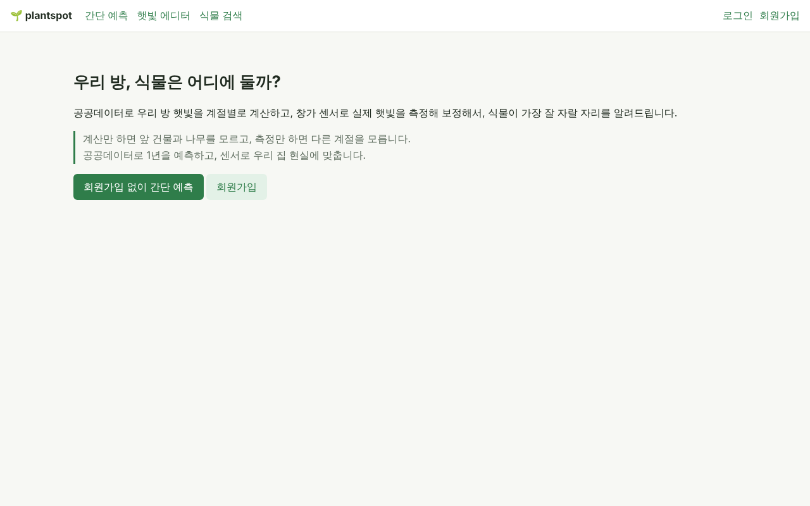

- 위쪽 메뉴: **간단 예측 · 햇빛 에디터 · 식물 검색** (누구나), 로그인하면 **우리 집 · 내 식물 · 내 파일**, 관리자는 **관리** 가 더 보입니다.
- 오른쪽 위에서 로그인·회원가입·로그아웃.

#### ② 간단 예측 (비회원) — `/try`

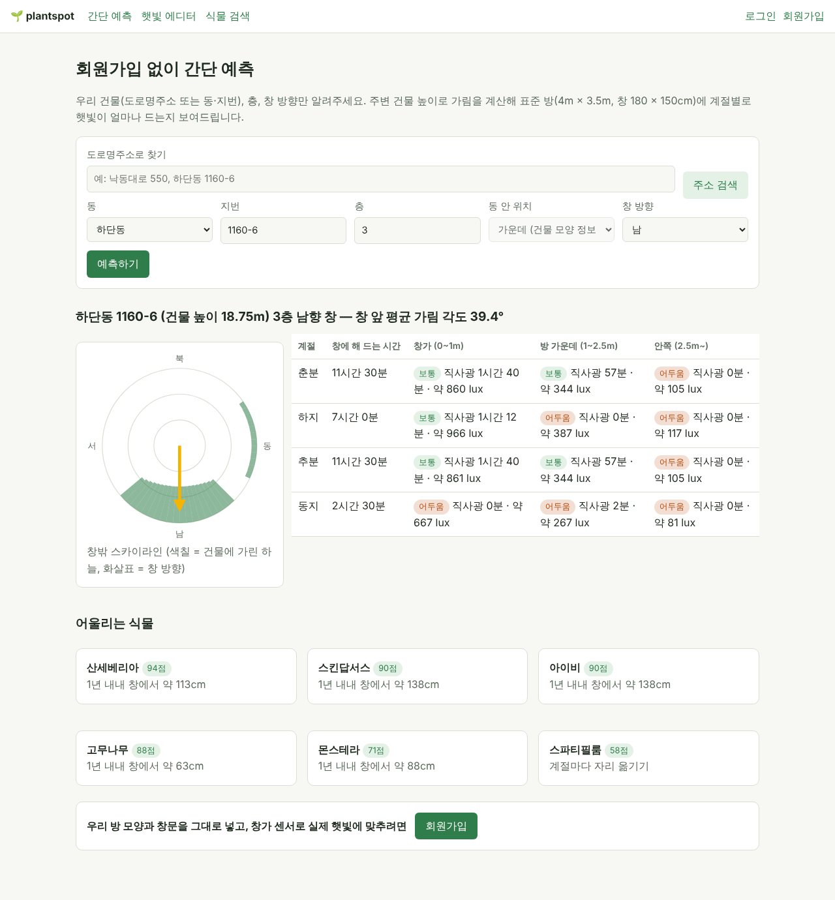

회원가입 없이 우리 건물·층·창 방향만으로 대략적인 햇빛과 어울리는 식물을 봅니다.

1. **우리 건물 찾기**: 도로명주소 검색(브이월드 키 필요) 또는 **동 선택 + 지번 입력** (예: 하단동 / 1160-6)
2. **층** 입력 (건물 층수보다 높으면 "지상 N층입니다" 오류), **창 방향** 선택
3. **동 안 위치**: 도로명주소 검색으로 건물을 고르면 "동쪽 끝 · 가운데 · 서쪽 끝" 등을 고를 수 있습니다 (끝 세대는 옆 건물 영향이 달라짐)
4. **예측하기** → 결과
   - **창밖 스카이라인**: 동그라미 가운데 = 머리 위, 바깥 = 지평선. 색칠된 부분이 주변 건물(·산)에 가린 하늘, 화살표가 창 방향
   - **계절별 표**: 춘분·하지·추분·동지마다 창에 해 드는 시간, 창가·방 가운데·안쪽의 직사광 시간·하늘빛(lux)·밝기 단계(밝음/보통/어두움)
   - **어울리는 식물**: 점수(100점 만점)와 놓을 자리(창에서 몇 cm, 또는 계절마다 옮기기)
5. 표준 방(4m × 3.5m, 창 180 × 150cm) 기준입니다. 우리 방 모양으로 계산하려면 회원가입

#### ③ 식물 검색 · 식물 상세 — `/plants`

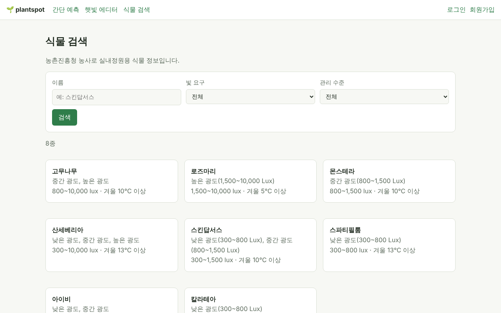

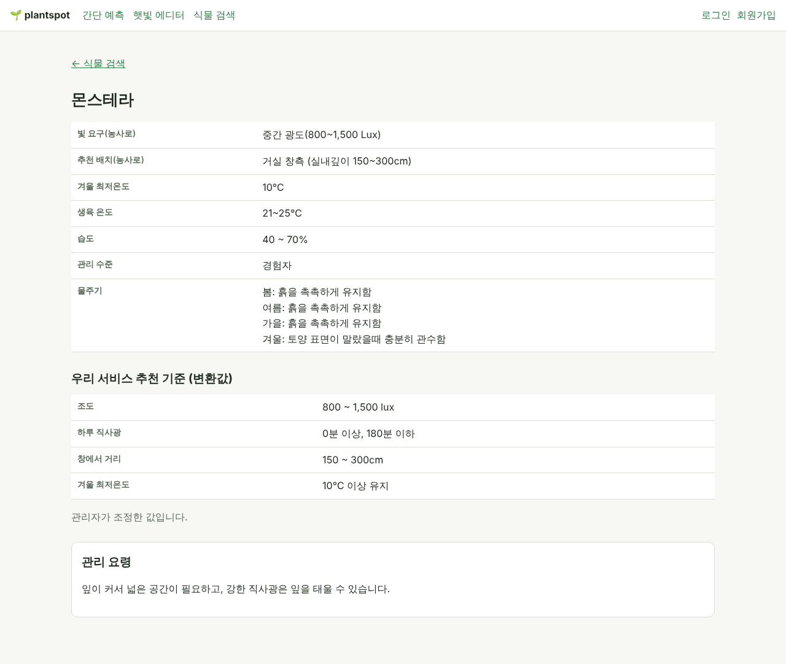

- 이름 검색, **빛 요구·관리 수준** 으로 거르기
- 식물을 누르면 상세: 농사로 정보(빛 요구, 추천 배치, 겨울 최저온도, 생육 온도, 습도, 관리 수준, 계절별 물주기, 관리 요령)와 **우리 서비스 추천 기준(변환값)**: 농사로 코드를 lux·하루 직사광·창에서 거리·겨울 최저온도로 바꾼 값

#### ④ 평면도 햇빛 에디터 (② 추가 프로그램) — `/editor`

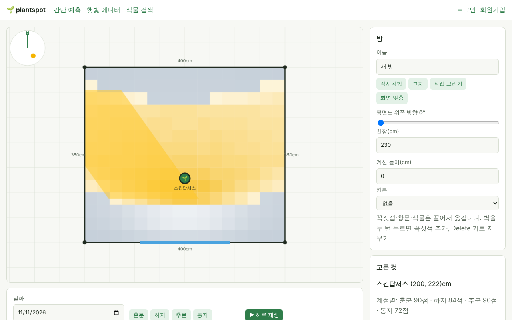

DB 와 상관없이 브라우저에서 돌아가는 프로그램입니다. 해 위치를 브라우저에서 서버와 같은 공식으로 계산합니다.

- **방 그리기**: 직사각형 · ㄱ자 · 직접 그리기. 꼭짓점·창문·식물은 끌어서 옮기고, 벽을 두 번 누르면 꼭짓점 추가, Delete 키로 지우기
- **창문 달기**: 벽을 눌러 고른 뒤 창문 추가 (폭·높이·창턱)
- **평면도 위쪽 방향**: 방이 실제로 어느 방향을 보는지 (북 0°)
- **날짜·시각 슬라이더**, 춘분·하지·추분·동지 버튼, **▶ 하루 재생**: 창으로 들어온 햇빛(노란 영역)이 움직이는 모습
- **하루 직사광 지도**: 노랄수록 오래, 파랄수록 어두운 칸
- **식물 끌어다 놓기**: 오른쪽 목록에서 식물을 방 안에 놓으면 그 자리의 점수(계절별)
- **저장**: 배치도 PNG 저장, 방 파일 내보내기·불러오기
- 비회원은 창 앞 가림 각도를 슬라이더로 직접 정하고, 회원은 우리 방을 불러와 실제 가림 각도로 계산 (⑬)

#### ⑤ 회원가입 · 로그인 — `/signup`, `/login`

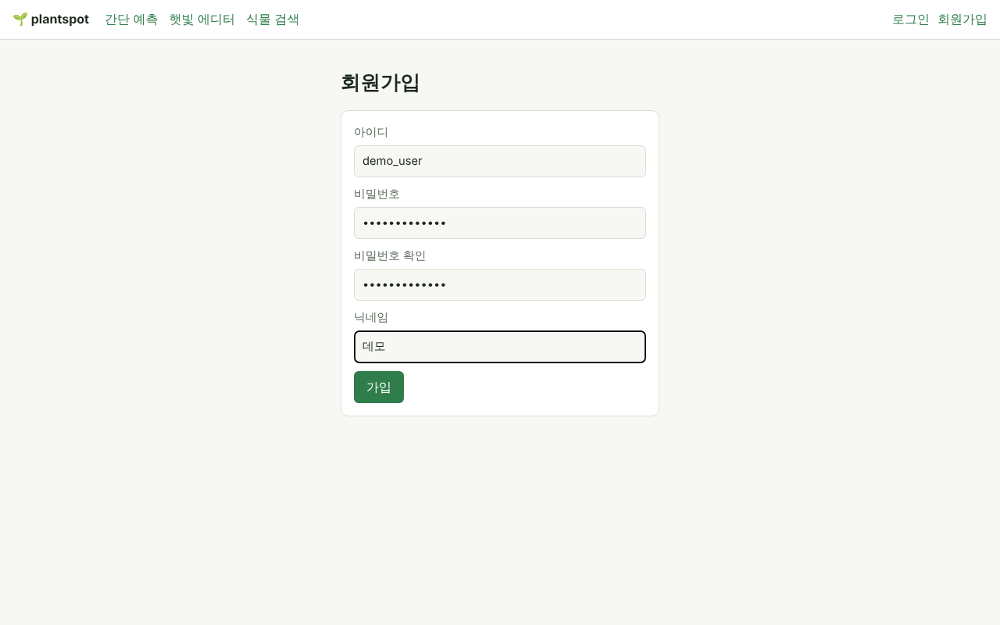

- 아이디: 영문 소문자·숫자·밑줄 4~20자, 비밀번호 8~64자, 닉네임
- 가입 후 로그인 화면으로 이동합니다

#### ⑥ 우리 집 등록 — `/my/houses`

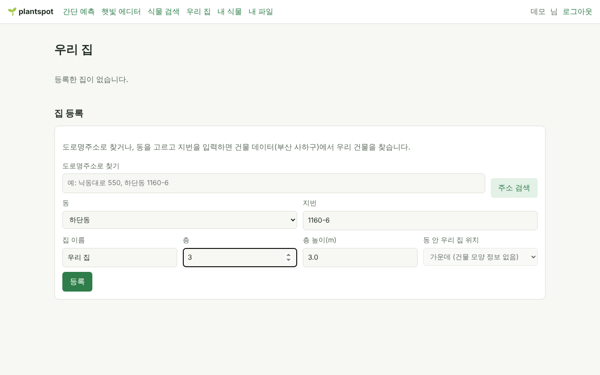

1. 도로명주소 검색 또는 **동 선택 + 지번**
   - 한 지번에 건물이 여러 동이면(아파트 단지) 목록에서 **우리 동** 을 고릅니다. 경비실 같은 작은 부속 시설은 "부속 시설 N개 더 보기" 에 접혀 있고, 목록은 동 번호 순입니다
2. **집 이름, 층, 층 높이**(기본 3.0m), **동 안 우리 집 위치**
3. **등록** → 집 화면으로

#### ⑦ 집 화면 — `/my/houses/{id}`

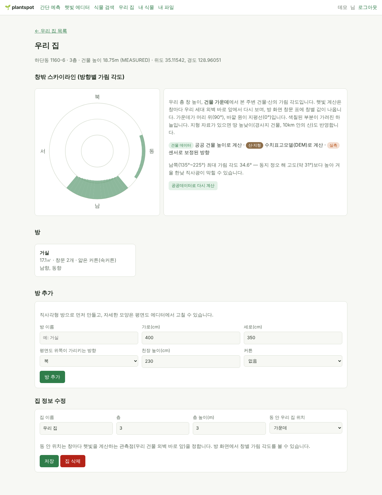

- **창밖 스카이라인**: 우리 층 높이·건물 가운데에서 본 방향별 가림 각도
  - 초록 = 건물 데이터, 갈색 = 산·지형(지형 자료가 있을 때), 주황 = 센서 실측으로 보정된 방향
  - 색칠된 칸에 마우스를 올리면 각도·원인·거리
  - 아래 요약: 남쪽 최대 가림 각도와 동지 정오 해 고도(약 31°) 비교
- **방** 목록 → 누르면 방 화면, **방 추가** (직사각형으로 만들고 모양은 에디터에서 고침)
- **집 정보 수정**: 층·층 높이·동 안 위치를 바꾸면 가림 각도·햇빛·추천을 다시 계산합니다

#### ⑧ 방 화면 — `/my/rooms/{id}`

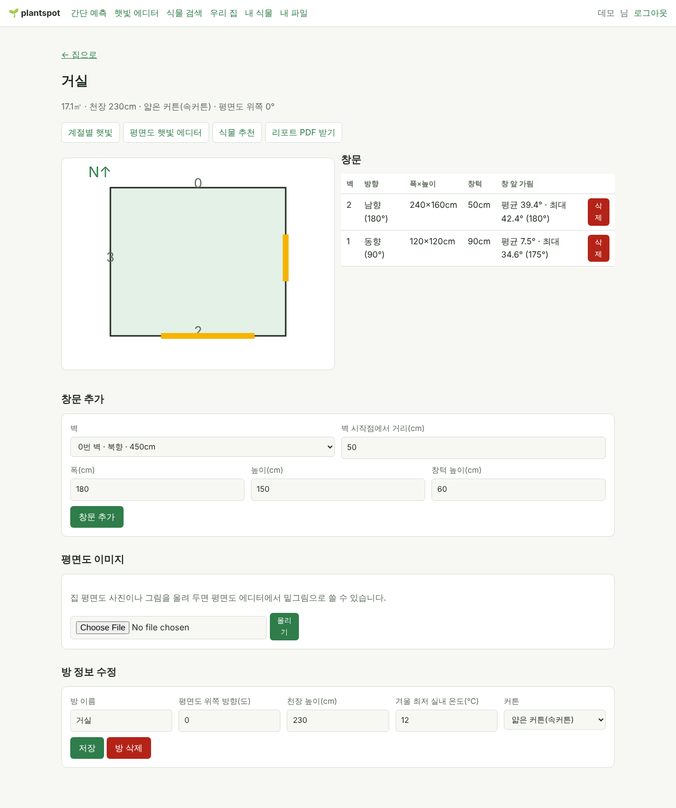

- 위쪽 바로가기: **계절별 햇빛 · 평면도 햇빛 에디터 · 식물 추천 · 리포트 PDF 받기**
- **창문 표**: 벽, 방향, 크기, 창턱, **창 앞 가림**(창마다 우리 세대 외벽 바로 앞에서 본 평균·최대 가림 각도)
- **창문 추가**: 벽, 벽 시작점에서 거리, 폭·높이, 창턱 높이
- **평면도 이미지** 올리기 (에디터 밑그림)
- **방 정보 수정**: 천장 높이, 평면도 위쪽 방향, **겨울 최저 실내 온도**(식물 겨울 경고에 사용), 커튼

#### ⑨ 계절별 햇빛 — `/my/rooms/{id}/sunlight`

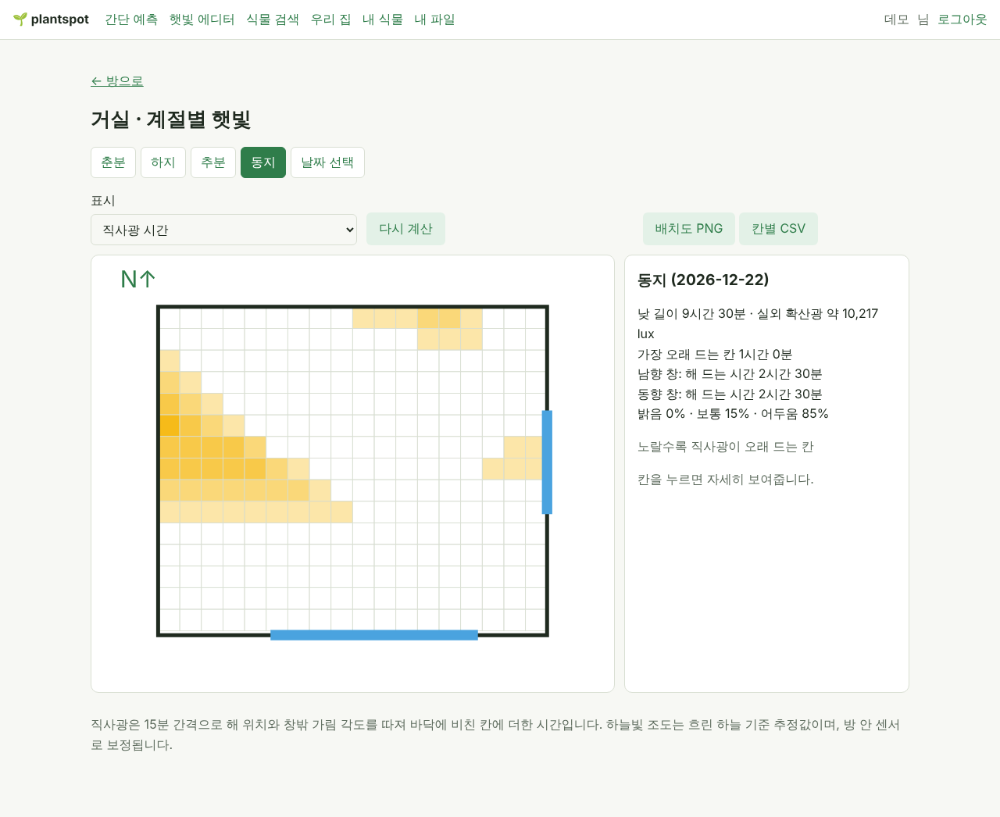

- **춘분 · 하지 · 추분 · 동지** 또는 **날짜 선택**
- **표시**: 직사광 시간 / 밝기 단계 / 하늘빛 조도(lux) — 25cm 칸마다 색으로
- 오른쪽 요약: 낮 길이, 창별 해 드는 시간, 가장 오래 드는 칸, 밝음·보통·어두움 비율
- 칸을 누르면 그 칸의 값, **배치도 PNG · 칸별 CSV** 내려받기, **다시 계산**

#### ⑩ 식물 추천 — `/my/rooms/{id}/recommendations`

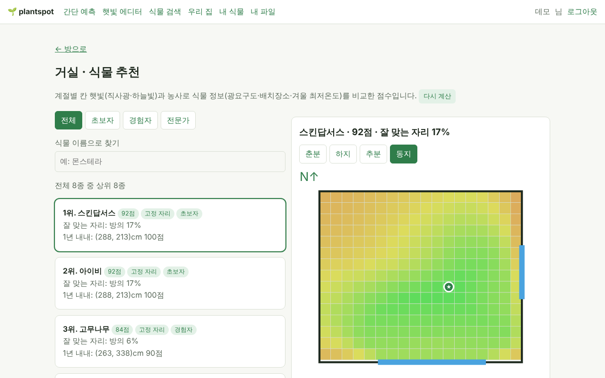

- 계절별 칸 햇빛과 농사로 식물 정보(광요구도·배치장소·겨울 최저온도)를 비교한 **점수(100점 만점)** 순위
- **관리 수준 탭**: 전체 · 초보자 · 경험자 · 전문가 (농사로 관리 수준)
- 카드: 순위·점수, **고정 자리**(1년 내내 한 자리) / **계절 이동**(계절마다 옮기기), 잘 맞는 자리 비율, 추천 자리 좌표, ⚠ 주의 사항(계절 이동 권유, 겨울 온도 경고 등)
- 오른쪽 **칸별 적합도 지도**: 초록 = 잘 맞음, 빨강 = 안 맞음, ★ = 추천 자리, 계절 탭으로 바꿔 보기
- 방이나 창문을 바꿨으면 **다시 계산**

**식물을 누르면 상세 정보 팝업**

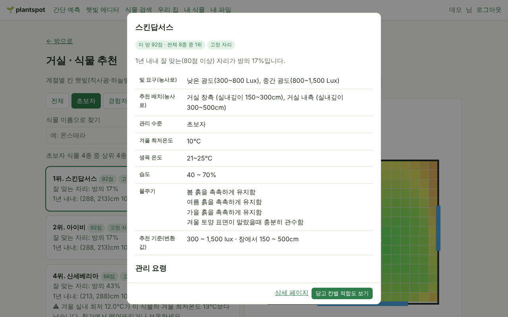

- 이 방에서의 점수·전체 순위, 농사로 정보, 추천 기준, 관리 요령, 상세 페이지 링크
- **닫고 칸별 적합도 보기** 또는 바깥을 누르면 닫힘

**이름으로 찾기**: 상위 추천에 들지 않은 식물도 이 방에서 몇 위·몇 점인지

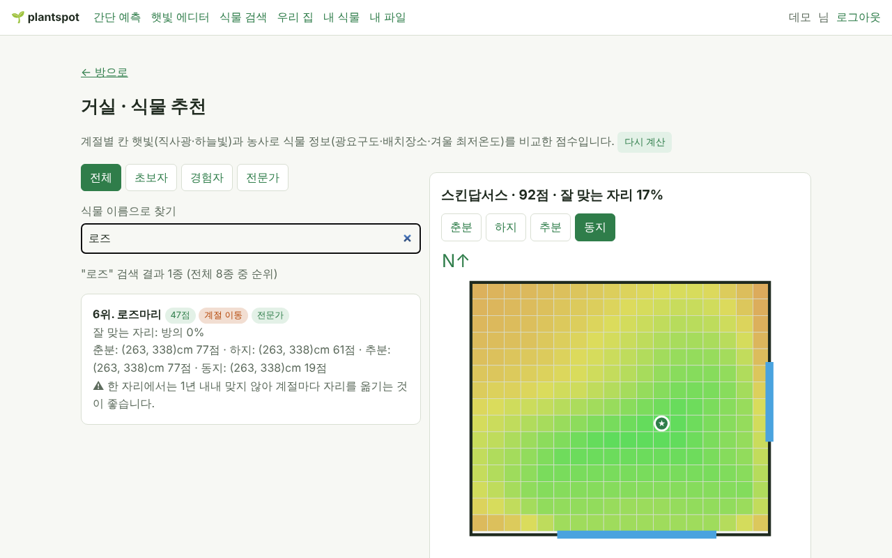

#### ⑪ 내 식물 — `/my/plants`

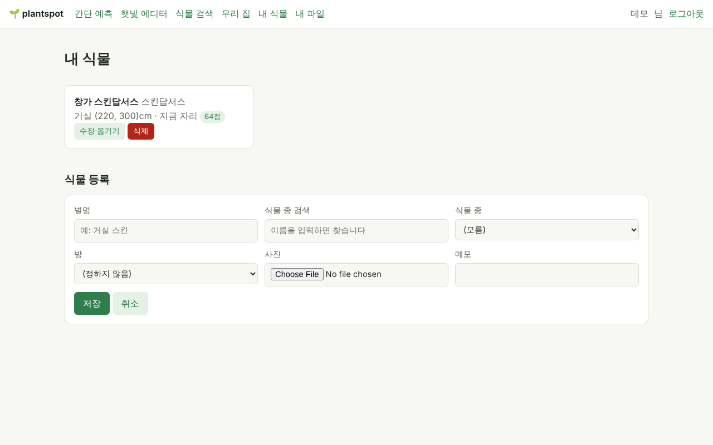

- **식물 등록**: 별명, 식물 종(검색), 방, 사진, 메모
- 카드: 놓은 방·자리와 **지금 자리 점수**, **수정·옮기기**
- 위쪽 알림: 지금 자리가 계절에 맞지 않으면 "더 알맞은 자리로 옮겨 보세요" 와 추천 자리

#### ⑫ 내 파일 (업로드·다운로드) — `/my/files`

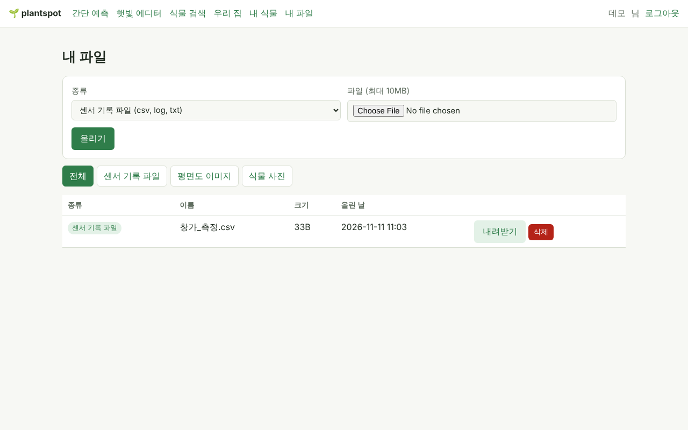

- 종류: **센서 기록 파일**(csv·txt·log), **평면도 이미지**·**식물 사진**(png·jpg·webp·gif 등), 한 파일 10MB 까지
- 목록에서 내려받기·지우기 (내 파일만 보임)

#### ⑬ 에디터로 우리 방 열기 — 방 화면 → 평면도 햇빛 에디터

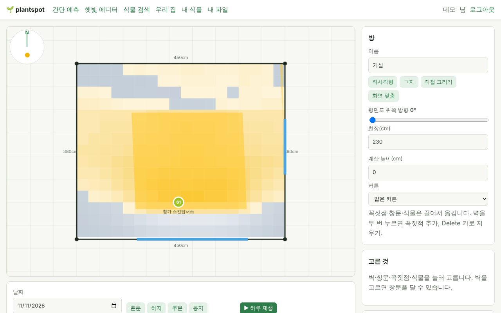

- 등록한 방 모양·창문·내 식물을 불러오고, **창별 실제 가림 각도**(건물·지형)로 햇빛을 계산합니다
- 센서 실측 값이 있으면 **보정 전후 겹쳐 보기**

#### ⑭ 관리자 — `/admin`

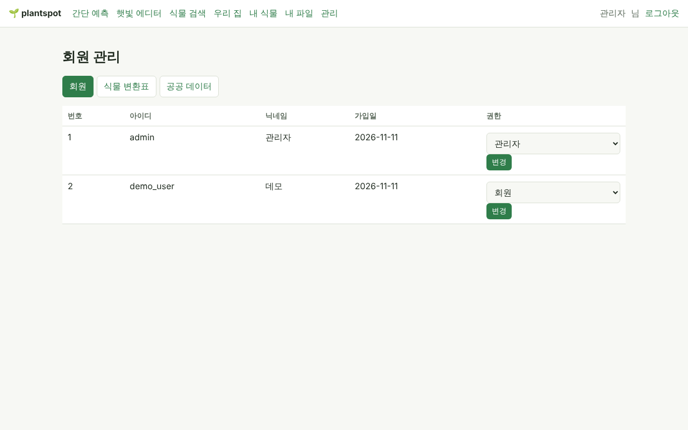

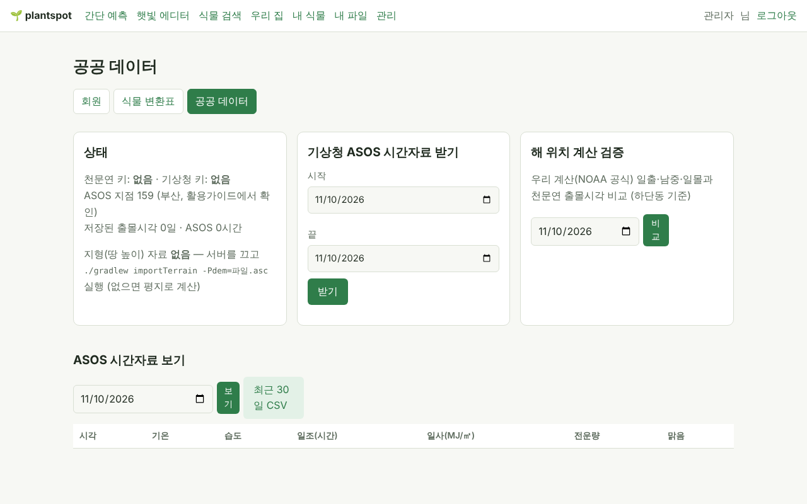

- **회원**: 회원 목록, 권한(회원·관리자) 변경
- **식물 변환표**: 식물마다 최소·최대 lux, 하루 직사광, 창에서 거리, 겨울 최저온도를 고치면 "조정됨" 으로 표시되고 농사로에서 다시 가져와도 유지, **자동값** 으로 되돌리기, **농사로 데이터 가져오기 시작**
- **공공 데이터**: 키·저장 상태, 지형 자료 상태, 기상청 ASOS 시간자료 받기·보기·CSV, 해 위치 계산 검증(우리 계산과 천문연 출몰시각 비교)

## 7. 문제가 생기면

| 증상 | 해결 |
|---|---|
| `Cannot find a Java installation ... languageVersion=26` | JDK 26 설치, 또는 `-PjavaVersion=25` (이클립스는 `gradle.properties` 에 `javaVersion=25`) |
| `Port 8080 was already in use` | 8080 을 쓰는 다른 프로그램(다른 서버)을 끄고 다시 실행 |
| 동 선택 목록이 "건물 데이터 없음" | DB 파일이 빠짐 → [3장](#3-db-파일-넣기-필수) 다시 확인 (서버 끄고 `data/plantspot.db` 교체) |
| 식물 추천에 식물이 없음 | DB 에 식물이 없음 → 식물이 들어 있는 DB 를 받거나 [8장](#8-데이터를-직접-만들-때-선택)의 `importPlants` |
| 도로명주소 검색 오류 | 브이월드 키 없음 → 동 선택 + 지번 입력 사용 |
| `database is locked` | SQLite 는 한 번에 한 프로그램만 씀 → 서버를 두 개 켰는지 확인, 가져오기 프로그램은 서버를 끄고 실행 |
| 처음 실행이 오래 걸림 | 라이브러리 내려받는 중 (처음 한 번만) |
| 이클립스에서 `Name for argument ... '-parameters'` | 최신 코드로 받았는지 확인 (모든 `@PathVariable`·`@RequestParam` 에 이름이 있음) |

## 8. 데이터를 직접 만들 때 (선택)

받은 DB 를 쓰면 이 장은 건너뛰면 됩니다. 아래는 **평가 기준 ① DB 데이터 생성 프로그램**이며, 웹 서버 없이 실행되고 끝나면 종료합니다. **서버를 끄고** 실행하세요.

| 명령 | 하는 일 | 필요한 것 |
|---|---|---|
| `gradlew.bat importBuildings -Pgpkg=C:/data/saha.gpkg` | 국토부 GIS 건물통합정보 → `building` (높이 보정 규칙 적용) | QGIS 에서 사하구만 GeoPackage 로 저장한 파일 |
| `gradlew.bat importPlants` | 농사로 실내정원용 식물 목록·상세 → `plant_species` (lux·직사광·창 거리로 변환) | `api.nongsaro.api-key` |
| `gradlew.bat importTerrain -Pdem=C:/data/saha_dem.asc` | 수치표고모델(DEM) → `terrain_grid`·`terrain_point` (산·경사지 가림 각도) | QGIS 에서 EPSG:5186, Arc/Info ASCII Grid 로 저장한 파일 |
| `gradlew.bat collectWeather -Pfrom=2026-11-01 -Pto=2026-11-07` | 기상청 ASOS 시간자료 → `weather_hour` | `api.kma.service-key` |

- 순서: **건물 → 식물 → 지형** (지형은 건물 범위를 기준으로 자릅니다)
- 경로는 `gradle.properties` 에 `gpkg=...`, `dem=...` 로 적어 두면 `-P` 없이 실행됩니다 (이 파일은 개인 경로라 커밋하지 마세요)
- 지형 파일 만들기: Copernicus DEM GLO-30 타일(N35 E128, N35 E129)을 QGIS 로 병합 → **래스터 → 투영 → 왜곡(재투영)** (대상 EPSG:5186, 쌍선형, NODATA -9999, 해상도 30) → **래스터 → 변환 → 변환(Translate)** 으로 `.asc` 저장

## 9. 기능과 평가 기준

| 평가 항목 | 이 프로젝트에서 |
|---|---|
| 회원 / 비회원 / 관리자 | Spring Security 7, 세션 로그인(JSON), `/my/**` 회원·`/admin/**` 관리자, 비회원은 간단 예측·식물 검색·에디터 |
| 파일 업로드·다운로드 | 평면도·식물 사진·센서 기록 업로드, PDF 리포트·계절별 배치도 PNG·칸별 햇빛 CSV·ASOS CSV 다운로드 |
| 3계층 | `controller → service → repository → domain` 패키지 |
| REST·검증·예외·로그 | `/api/**` 자원 중심 URL, Bean Validation + 서비스 검증(예: 건물 층수보다 높은 층 막기), `GlobalExceptionHandler` 공통 오류 JSON, SLF4J 로그 |
| DB 파일 제출 | SQLite `data/plantspot.db` |
| **① DB 데이터 생성 프로그램** | 건물(GeoPackage)·식물(농사로 API)·지형(DEM)·기상(ASOS) 가져오기 + 계산 결과(가림 각도·칸별 햇빛·추천) 저장 |
| **② DB 와 무관한 추가 프로그램** | 평면도 햇빛 에디터 (`/editor`, 브라우저 캔버스, 해 위치를 브라우저에서 서버와 같은 공식으로 계산) |

**핵심 계산**
- 해 위치(15분 간격) + 방향별 가림 각도(주변 300m 건물 + 10km 산, 창마다 우리 건물 외벽 바로 앞에서) → 직사광 여부
- 창문 네 모서리를 바닥에 투영 → 25cm 칸마다 직사광 시간·하늘빛(lux), 계절 대표일 4개
- 농사로 광요구도·배치장소·겨울 최저온도 ↔ 칸별 결과 → 식물 적합도 점수, 고정 자리 / 계절 이동 자리

## 10. 프로젝트 구조

```
src/main/java/com/springboot
├── controller/   REST 컨트롤러(/api/**) + 화면 주소(PageController)
├── service/      비즈니스 로직
├── repository/   Spring Data JPA
├── domain/       엔티티·enum
├── dto/          요청·응답 객체
├── calculator/   계산 (해 위치, 가림 각도, 지형, 햇빛, 식물 점수, 좌표 변환)
├── client/       외부 API (농사로·천문연·기상청·브이월드)
├── report/       PDF·PNG
├── tool/         ① 데이터 생성 프로그램
├── config/       보안·관리자·DB 폴더·DB 고치기
├── security/ event/ exception/
src/main/resources
├── templates/    화면 (Thymeleaf)
├── static/       css, js, editor/ (② 평면도 햇빛 에디터)
└── application.properties (+ application-local.properties: 키, 커밋 금지)
data/plantspot.db  DB (저장소에 없음, 따로 받음)
```

- 기술: Spring Boot 4.1 (Spring Framework 7, Security 7, Hibernate 7), Java 26, Gradle 9.8.2, Thymeleaf, SQLite, PDFBox
- 테스트: `gradlew.bat test` (단위·API·화면 테스트), 브라우저 계산과 서버 계산 일치는 `node src/test/js/editor-parity.js`

## 11. 데이터 출처

- 국토교통부 GIS 건물통합정보 (브이월드)
- 농촌진흥청 농사로 실내정원용 식물 Open API
- 한국천문연구원 출몰시각 정보 (공공데이터포털)
- 기상청 종관기상관측(ASOS) 시간자료 (공공데이터포털)
- 브이월드 검색 API (주소 → 좌표)
- 수치표고모델: Copernicus DEM GLO-30 (© DLR e.V. 2010-2014 and © Airbus Defence and Space GmbH 2014-2018, provided under COPERNICUS by the European Union and ESA)
